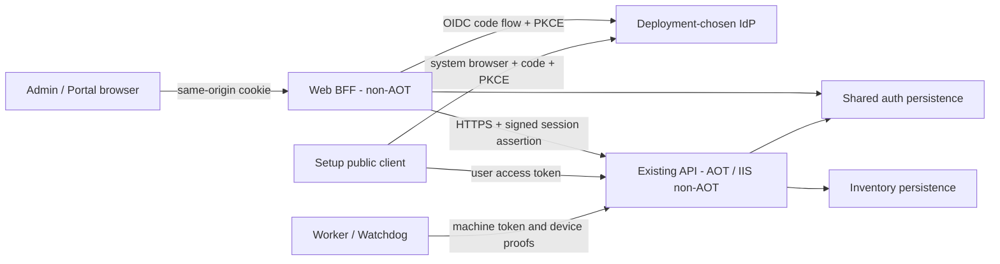
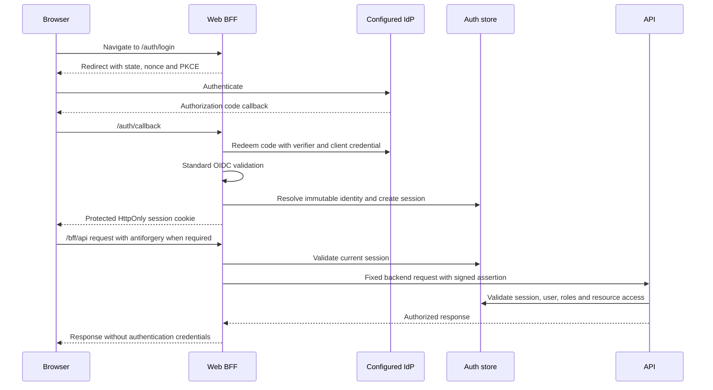
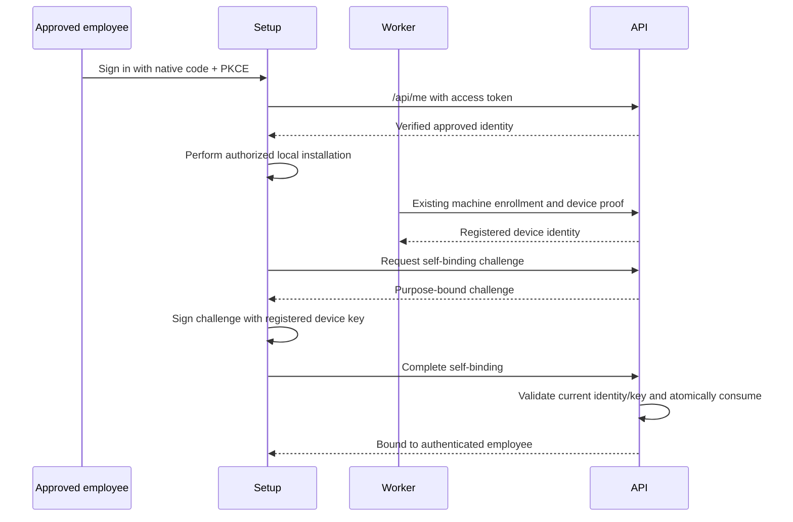

# 공급자 중립 OIDC/OAuth 직원·관리자 인증 구조 설계

> 상태: **미구현 설계**. 이 문서의 새 호스트, 인터페이스, 설정과 API는 현재 제품에 추가된 기능이 아니다. 구현과 배포는 후속 작업이다. 특정 IdP의 도입·지원 인증이나 실환경 보안 검증을 완료했다는 의미도 아니다.

## 1. 목표와 결정

IdP 선택은 솔루션 도입자의 책임이다. 제품은 표준 OpenID Connect 로그인과 OAuth API 호출을 연결할 인터페이스, 라우트, 설정·검증 계약을 제공한다. 공급자 이름에 따른 분기나 전용 SDK를 핵심 경로에 넣지 않는다. 인증된 사람이 무엇을 할 수 있는지는 외부 역할이 아니라 제품의 DB가 결정한다.

| 항목 | 결정 |
|---|---|
| 브라우저 | 비-AOT `SwLicenseWatcher.Web` BFF가 표준 ASP.NET Core OIDC·Cookie 핸들러를 사용한다. 기존 API의 AOT 배포는 유지한다. |
| 화면 | 관리자 `/admin`과 별도 `SwLicenseWatcher.Portal` WASM 앱 `/portal`을 제공한다. |
| Setup | native public client, 시스템 브라우저, authorization code + PKCE, RFC 8252 loopback redirect를 사용한다. |
| 사용자·역할 | 로컬 사용자, 불변 외부 신원, 사용자-역할 관계를 DB에서 관리한다. IdP role/group은 업무 권한을 자동 부여하지 않는다. |
| 기기 연결 | 승인된 직원은 등록 장치 키의 증명에 성공하면 해당 PC를 **본인에게 바로 추가 연결**할 수 있다. 이미 다른 직원과 연결된 PC도 허용하는 N:M 정책이다. 관리자도 연결을 관리한다. |
| 비상·자동화 | AdminToken은 유지한다. 브라우저 비상 로그인은 서버 세션으로 교환하며 토큰을 sessionStorage에 보관하지 않는다. |
| 전환 | 호환 모드와 SSO 필수 모드를 제공하고 도입자가 전환한다. 무인 에이전트 동작은 직원 로그인 수명과 분리한다. |

**공급자 중립은 무조건적인 자동 호환을 의미하지 않는다.** 도입자가 표준 계약을 만족하는 issuer, client, scopes, API 토큰 검증과 신원 연결을 구성한다. 필수 조건이 없으면 해당 기능 활성화 또는 요청이 명시적으로 실패한다. 임의 토큰을 허용하는 fallback으로 호환성을 구현하지 않는다.

범위는 인증·인가 경계, 사용자·기기 연결, 포털·Setup 접근 계약, 데이터·배포 변경과 검증 기준이다. 공급자 전용 연동 코드, IdP 운영 설정 대행, 자동 공급자 탐지, 자동 계정 병합, SAML/LDAP/SCIM, 독자 Authorization Server, 에이전트 인증의 전면 교체는 범위 밖이다.

직원 셀프서비스는 연결된 PC의 소프트웨어·위반·기기 알림 조회와 제거 요청을 중심으로 한다. 소프트웨어 예외 요청의 확장 접점은 열되, 새로운 승인 엔진이나 승인 시 회사 전체 정책 자동 변경을 이 인증 작업에 포함하지 않는다.

## 2. 현재 구현과 제약

| 현재 사실 | 코드 근거 | 설계에 미치는 영향 |
|---|---|---|
| AgentToken/AdminToken이 모두 필수이며 서로 달라야 한다. JWT도 현재는 관리자용이다. | [Configuration.cs](../src/SwLicenseWatcher.Core/Configuration.cs), [RequestAuthenticator.cs](../src/SwLicenseWatcher.Api/RequestAuthenticator.cs), [JwtAccessTokenAuthenticator.cs](../src/SwLicenseWatcher.Api/JwtAccessTokenAuthenticator.cs) | 레거시 관리자 JWT와 새로운 일반 사용자 토큰을 같은 권한 모델로 해석하면 안 된다. |
| 경로·method 분류와 미들웨어가 인증 여부를 결정한다. 실패는 주로 401이다. | [EndpointPolicies.cs](../src/SwLicenseWatcher.Api/EndpointPolicies.cs), [ApiPipeline.cs](../src/SwLicenseWatcher.Api/ApiPipeline.cs) | endpoint metadata, actor 구분, 역할·리소스 기반 인가로 전환해야 한다. |
| `/admin`은 정적 WASM이며 사용자가 입력한 토큰을 sessionStorage에 저장한다. | [TokenStore.cs](../src/SwLicenseWatcher.Admin/Services/TokenStore.cs), [AdminAuthHandler.cs](../src/SwLicenseWatcher.Admin/Services/AdminAuthHandler.cs), [App.razor.cs](../src/SwLicenseWatcher.Admin/App.razor.cs) | 로그인 화면, 요청 handler, 만료·권한 부족 처리와 다운로드 경로가 함께 바뀐다. |
| API가 Admin 정적 파일을 publish/serve하고 CSP는 `connect-src 'self'`이다. | [API 프로젝트](../src/SwLicenseWatcher.Api/SwLicenseWatcher.Api.csproj), [AdminStaticFiles.cs](../src/SwLicenseWatcher.Api/AdminStaticFiles.cs) | BFF 모드에서는 정적 파일 소유 호스트와 배포 구성을 이관한다. |
| 장치 증명은 이미 수집·등록 장치 작업에 적용된다. 현재 증명 payload는 v1 정적 형식이다. | [DeviceEnrollmentService.cs](../src/SwLicenseWatcher.Api/DeviceEnrollmentService.cs), [DeviceIdentity.cs](../src/SwLicenseWatcher.Core/DeviceIdentity.cs) | 새 사람-기기 연결에는 목적과 단회성 challenge가 필요하다. 기존 기계 프로토콜을 이 문서에서 전부 교체하지 않는다. |
| Setup은 UI 전에 승격한다. 실제 Setup 본체는 비-AOT이고 런처는 AOT이다. | [Setup Program.cs](../src/SwLicenseWatcher.Setup/Program.cs), [Setup 프로젝트](../src/SwLicenseWatcher.Setup/SwLicenseWatcher.Setup.csproj), [런처 프로젝트](../src/SwLicenseWatcher.Setup.Launcher/SwLicenseWatcher.Setup.Launcher.csproj) | 브라우저 프로세스 계정으로 직원 신원을 추정할 수 없다. OAuth 구현 의존성은 비-AOT 본체에 둔다. |
| 제거 요청과 수동 업그레이드 인가는 AgentToken·장치 증명 경로를 사용한다. | [UninstallQueryApi.cs](../src/SwLicenseWatcher.Api/UninstallQueryApi.cs), [UpgradeAuthorizationApi.cs](../src/SwLicenseWatcher.Api/UpgradeAuthorizationApi.cs), [UpgradeAuthorizationApiClient.cs](../src/SwLicenseWatcher.Setup.Core/UpgradeAuthorizationApiClient.cs) | SSO 필수 전환에서 기존 생성·인가 경로를 빠뜨리면 UI만 강제하는 결과가 된다. |
| 저장소는 SQL Server, MySQL/MariaDB, PostgreSQL과 설정 가능한 SQL 식별자를 지원한다. | [PersistencePorts.cs](../src/SwLicenseWatcher.Application/PersistencePorts.cs), [Infrastructure DI](../src/SwLicenseWatcher.Infrastructure/DependencyInjection.cs), [Configuration.cs](../src/SwLicenseWatcher.Core/Configuration.cs) | 인증 테이블도 같은 엔진·식별자·트랜잭션 지원 범위를 따른다. |

[ASP.NET Core Native AOT 지원 표](https://learn.microsoft.com/en-us/aspnet/core/fundamentals/native-aot?view=aspnetcore-10.0)는 JWT Authentication과 Other Authentication을 구분한다. 이것은 직접 만든 OIDC 구현의 안전성을 보증하지 않는다. 표준 OIDC·Cookie 핸들러를 비-AOT 호스트에 두는 이유이다.

현재 `/health`, Admin 정적 파일, Worker 패키지 다운로드의 익명 제공은 각각 [PublicPaths.cs](../src/SwLicenseWatcher.Api/PublicPaths.cs)와 endpoint 구현에 있는 의도된 동작이다. 정적 UI가 공개라는 이유만으로 업무 API를 공개하지 않는다. 과거 보안심의 문서의 당시 미수정 상태를 현재 코드의 사실로 재사용하지 않는다.

## 3. 목표 구조와 책임

`SwLicenseWatcher.Web`은 새 호스트의 가칭이다. 같은 HTTPS origin의 `/admin`, `/portal`, `/auth/**`, `/bff/api/**`를 담당한다. 기존 API는 `/api/**`, `/health`, 에이전트·업데이트 경로를 담당하고 브라우저 쿠키를 직접 인증하지 않는다. 도입 환경의 IIS/reverse proxy 등이 이 라우팅을 구성한다.

브라우저는 `/bff/api/...`를 호출하고 BFF는 허용된 method/path만 고정 API backend로 전달한다. 임의 URL 프록시를 만들지 않는다. 브라우저가 제공한 Authorization, Cookie, 사용자·역할·내부 세션 전달 헤더는 API로 그대로 중계하지 않는다. 외부 origin 간 credentialed CORS를 기본 전제로 하지 않는다.

Web와 API는 Application의 신원·세션·권한 계약과 Infrastructure의 인증 저장소 구현을 공유한다. 두 호스트에 인가 규칙을 복제하지 않고 **API가 현재 DB 역할과 리소스 범위를 최종 검사**한다. 기존 `Core <- Application <- Infrastructure` 의존성 방향을 유지하고, OIDC 핸들러·HTTP 타입을 Core 계약으로 전파하지 않는다.

Cookie ticket의 직렬화·복호화는 비-AOT Web의 책임이다. API는 도메인 세션의 상태·사용자·actor metadata만 조회한다. 공유 저장소라는 이유로 API에 Cookie/OIDC 핸들러나 AuthenticationTicket 역직렬화 의존성을 다시 넣지 않는다.

Admin/Portal은 Core의 안전한 응답 DTO만 사용한다. native OAuth 구체 구현은 비-AOT Setup 본체에 두고 Setup.Core에는 필요한 작업 계약을 둔다. AOT 런처가 표준 로그인 라이브러리 전체를 참조하도록 만들지 않는다.

### 3.1 BFF에서 API로 신원 전달

BFF 로그인에 성공했다고 해서 IdP가 이 API를 위한 access token까지 발급하는 것은 아니다. 따라서 브라우저 경로는 외부 access token 중계에 종속시키지 않는다. BFF가 서버 세션을 증명하는 **내부 assertion**을 사용한다.

| 요소 | 계약 |
|---|---|
| 발급 | BFF가 서버 세션을 검증한 후 JWT 라이브러리와 전용 비대칭 signing key로 생성한다. 브라우저 또는 native client에 발급하지 않는다. |
| 내용 | 별도 token type, 고정 issuer/audience, 세션 참조, actor 종류, 사람 actor의 사용자 참조, 발급·만료와 key ID 등 최소 필드. 외부 role이나 클라이언트가 입력한 권한은 넣지 않는다. |
| 검증 | API의 전용 스킴이 허용 키·알고리즘·type·issuer·audience·수명을 검사한다. 세션의 actor/사용자와 assertion이 일치해야 한다. |
| 현재 상태 | 서명이 유효해도 세션 폐기·만료, 사용자 비활성, 권한 제거 시 거부한다. 업무 인가는 DB 현재 상태로 결정한다. |
| 분리 | 외부 access token과 다른 신뢰 키 공간을 사용한다. 토큰의 `iss`, `jku` 등으로 임의 검증 서버·키를 신뢰하지 않는다. |
| 수명·노출 | 원본 세션보다 오래 유효하지 않은 단기 서버 간 credential이다. TLS를 사용하고 URL·브라우저·로그에 노출하지 않는다. |

API가 요구하는 인가는 assertion 서명만으로 끝나지 않는다. 임의 UserId를 서명해 보내거나 다른 세션의 참조를 붙였을 때도 저장소의 실제 세션과 일치하지 않으면 거부한다. 미연결 신원은 업무 요청용 사용자 assertion을 발급받지 않는다. 자신의 로그인 상태는 Web의 `/auth/me`에서 확인한다.

BreakGlass는 사람과 다른 actor이므로 가짜 UserId나 외부 신원을 만들지 않는다. 비상 세션 참조와 actor 일치를 검증한 뒤 허용된 관리 작업만 수행한다. 사람에게 필요한 외부 신원 연결 검사를 비상 actor에 억지로 적용해 초기 관리자 지정이 불가능해지거나, 반대로 비상 actor를 `/api/me`의 사람으로 취급하지 않는다.

내부 assertion은 외부 OAuth 토큰이나 독립 IdP 서비스가 아니다. 외부 앱을 위한 token endpoint, refresh token, consent 시스템을 추가하지 않는다. 반대로 AdminToken을 모든 사용자 요청에 붙여 중계하거나, unsigned 사용자 헤더만 신뢰하는 방식도 사용하지 않는다.

키 교체는 API에 새 검증 키를 배포한 뒤 BFF 발급 키를 전환하고, 이전 assertion의 최대 수명·허용 시계 오차가 지난 뒤 구 키를 제거하는 순서로 설계한다. unknown key나 서명 실패를 다른 스킴으로 재해석하지 않는다.

## 4. 공급자 중립 연동 인터페이스

다음 이름은 책임 경계의 예시이며, 각각 별도 프로젝트나 범용 플러그인 프레임워크를 만들라는 요구가 아니다.

| 접점 | 입력·성공 결과 | 실패·신뢰 조건 |
|---|---|---|
| 표준 OIDC 핸들러 | 서버 설정의 issuer/metadata, Web client와 credential, scopes, callback → 검증된 로그인 신원 | state/nonce/PKCE, issuer/audience, 서명·수명 검증은 표준 핸들러/검증 라이브러리에 맡긴다. 공급자 이름별 우회는 없다. |
| `IExternalAccessTokenValidator` | API에 전달된 bearer와 서버 검증 설정 → 검증된 issuer/subject, token 용도, audience, 위임 범위·유효성 | 무효 토큰, 계약을 만족하지 않는 토큰, 설정 오류, 검증 서비스 장애를 구분한다. unvalidated ClaimsPrincipal이나 단순 `true`를 인증 결과로 받지 않는다. |
| `IExternalIdentityResolver` | 검증된 불변 외부 신원과 그 검증 namespace → 내부 사용자 또는 미연결 상태 | 이메일·표시명 자동 병합 금지. 충돌·모호한 연결은 거부한다. 변경된 매핑으로 기존 권한을 묵시적으로 승계하지 않는다. |
| Native 공개 설정 | 설치 대상 서버의 `/auth/config` → public client ID, issuer/metadata, 요청 scopes, 지원 loopback 경로, API 주소와 기능 활성 상태 | client secret, introspection credential, signing key, AdminToken은 반환하지 않는다. 비활성/미설정 기능을 정상 토큰 획득 경로처럼 표시하지 않는다. |

도입자는 IdP를 정하고 Web confidential client와 Setup public client를 등록한다. issuer, metadata, redirect, API audience·scope 및 필요한 토큰 검증을 구성한다. 제품은 해당 설정을 검증하고 표준 흐름을 실행한다. 실제 IdP 선정이나 공급자별 지원 인증은 제품 인터페이스 설계의 선행 조건이 아니다.

### 4.1 토큰 의미와 검증 확장

- **ID token:** Web 또는 native client를 위한 로그인 증거이다. 해당 client audience와 로그인 트랜잭션을 검증한다. API access token 대신 사용하지 않는다.
- **외부 access token:** 이 API를 위한 호출 위임이다. API가 자신의 audience, 신뢰할 발급자, 유효성, 사용자 token 여부와 필요한 scope를 검증한다. client는 내용을 파싱해 업무 권한을 결정하지 않는다.
- **내부 assertion:** BFF 서버 세션을 API에 증명한다. 외부 IdP 검증 설정과 별도이며 로컬 업무 권한을 대체하지 않는다.
- **기계 credential:** AgentToken과 장치 증명이다. 사람 token의 부재를 기계 credential로 보충해 사람 권한을 부여하지 않는다.

기본 외부 검증 경로는 JWT resource server이다. 서명·허용 알고리즘·정확한 issuer·API audience·수명·위임 scope를 검증하고, discovery/JWKS 캐시·키 교체·unknown key 재조회에는 제한과 장애 처리를 둔다.

Opaque access token에는 [RFC 7662 introspection](https://www.rfc-editor.org/rfc/rfc7662.html) 같은 표준 어댑터를 연결할 수 있도록 같은 검증 계약을 정의한다. `active=true`만으로 충분하지 않다. 검증 endpoint 자체의 신뢰, 이 API에 대한 용도, 유효성, 안정적 사용자 식별과 위임 범위를 확인할 수 있어야 한다. 필요 정보가 없는 응답은 실패이다. introspection cache를 추가한다면 토큰 만료와 철회 지연 상한을 함께 규정한다.

OIDC 로그인이 된다는 이유로 모든 공급자가 자체 API용 access token을 발급한다고 가정하지 않는다. Web 로그인과 native/API 인증은 별도 활성화·검증 조건을 가진다. 필요한 계약이 충족되지 않은 native 기능은 미설정으로 표시하고 활성화를 거부한다. 실제 어댑터 구현과 공급자 시험은 후속 작업이다.

### 4.2 불변 신원과 여러 client

표준 기본 외부 키는 검증된 `issuer + sub`이다. issuer와 subject는 임의로 대소문자 변경, 슬래시 제거, Unicode 정규화를 하지 않는다. 사용자에게 보여주는 이름과 식별 키를 분리한다.

같은 사람이라도 client별 pairwise subject가 다를 수 있다. 안정적인 검증 규칙이 있으면 resolver로 연결하고, 없으면 검증된 외부 신원을 관리자가 명시적으로 연결한다. **같은 이메일을 가진다는 이유로 연결하지 않는다.** `email_verified=true`도 기존 권한을 상속할 충분조건이 아니다.

resolver의 검증 namespace나 claim 규칙을 바꾸는 것은 데이터 마이그레이션이다. 한 외부 신원은 동시에 둘 이상의 내부 사용자를 가리키지 않는다. 이미 다른 활성 사용자에게 결속된 신원은 조용히 이전하지 않는다. 연결 변경의 이전·새 대상과 승인 actor를 감사한다.

외부 신원의 연결을 바꾸거나 해제하면 이전 연결에 기초한 세션도 폐기한다. API는 현재 외부 신원 연결과 세션의 사용자 참조가 여전히 일치하는지 확인한다. native 요청도 변경된 resolver 결과로 인가하며, 이전 연결에 묶인 challenge를 새 사용자에게 승계하지 않는다.

## 5. 로컬 사용자·역할·초기 관리자

인증 성공, 외부 신원의 로컬 연결, 직원 승인, 업무 권한을 별개 단계로 다룬다. 최초 로그인으로 외부 신원을 기록할 수는 있지만, 미연결·미승인 사용자는 업무 API를 사용할 수 없다. 자동 가입이 곧 User 또는 Admin 역할 부여가 되어서는 안 된다.

| 역할/actor | 허용 범위 |
|---|---|
| User | 승인된 사람의 자기 연결 PC·요청 조회, 허용된 자기 요청, native 장치 증명 기반 자기 연결 |
| Viewer | User의 자기 작업 + 관리 데이터 읽기. 관리 설정·다른 사람의 권한·원격 지시는 변경하지 못한다. |
| Admin | Viewer 범위 + 관리 작업. `/api/me/**`에서는 여전히 자기 범위만 사용하고, 대리 작업은 관리자 API로 구분한다. |
| Automation | AdminToken으로 인증된 관리자 자동화. 관리 API를 사용할 수 있지만 직원 UserId가 되지 않는다. |
| BreakGlass | 비상 로그인으로 생성된 관리자 세션. 개인 사용자로 위장하지 않으며 별도 actor로 감사한다. |
| Agent | 기계 credential과 필요한 장치 증명으로 인증한다. 사람 또는 관리자 역할을 상속하지 않는다. |

역할은 로컬 사용자-역할 관계에서 읽는다. API endpoint는 인증 스킴, actor 종류, 로컬 역할, 외부 토큰의 필요한 위임 scope, 리소스 범위를 모두 확인한다. `scope=admin`, provider의 `roles`, 특정 client ID 또는 subject 필드의 존재만으로 관리자나 사람이라고 판단하지 않는다.

### 5.1 승인·신원 연결

미연결 외부 신원은 `/auth/me`에서 자신의 로그인·승인 상태를 확인할 수 있다. 관리자는 검증 이력이 있는 외부 신원을 새 로컬 사용자 또는 확인한 기존 사용자에 연결하고 역할을 부여한다. 이미 다른 사람에게 연결된 신원은 자동으로 옮기지 않는다.

웹과 native의 서로 다른 subject를 연결할 때도 같은 절차를 사용한다. native의 유효한 토큰을 처음 보는 API는 최소 신원 확인 경로에서 미연결 상태를 알려줄 수 있지만 인벤토리·바인딩 권한을 부여하지 않는다. 연결 완료 뒤 세션을 갱신하거나 다시 로그인해 사용자 참조를 확정한다.

사전 등록·승인 UI에서 이메일은 검색·표시 보조 정보이다. 관리자가 이메일로 후보를 찾더라도 최종 작업 대상은 검증된 외부 신원 ID와 내부 UserId이다. 클라이언트가 제출한 이메일을 로그인 도중 권한 있는 레코드에 자동 결속하는 경로는 만들지 않는다.

### 5.2 BootstrapAdmins와 비상 로그인

BootstrapAdmins는 issuer와 불변 subject를 정확하게 지정한다. 해당 신원이 실제로 검증된 뒤 초기화를 한 번만 수행한다. DB에 초기화 이력을 남기고, 이후 관리자가 제거한 역할을 로그인마다 복구하지 않는다. 설정에 있는 표시명·이메일은 초기 관리자 판별 조건이 아니다.

불변 신원을 미리 지정하기 어려우면 비상 로그인으로 검증된 대기 신원을 확인한 뒤 관리자를 지정한다. 첫 번째 로그인 사용자에게 무조건 Admin을 주지 않는다.

`POST /auth/break-glass`는 AdminToken을 한 번 제출받아 검증하고 별도의 서버 세션을 만든다. token과 session ID를 로그인 성공 응답·URL·로그에 반환하지 않는다. 폼의 token 값을 즉시 비우고 browser storage에 남기지 않는다. 비상 로그인에도 HTTPS, anonymous antiforgery, 정확한 origin 검사, 접근·실패 횟수 제한을 적용한다.

비상 경로 활성화, 허용 네트워크, 세션 수명과 token 회전 시 비상 세션 폐기는 서버 정책이다. proxy를 사용하면 클라이언트 IP는 명시적으로 신뢰한 proxy에서만 해석한다. 모든 요청을 공유 AdminToken으로 프록시하는 대체 수단으로 사용하지 않는다.

마지막 활성 일반 관리자를 제거하거나 비활성화하는 경쟁 요청은 하나의 트랜잭션 경계에서 검사한다. 해당 관리자의 마지막 로컬 로그인 신원 연결을 해제하는 경우도 포함한다. 비상 credential이 있다는 이유로 이 검사를 생략하지 않는다. 이는 로컬 연결 보호이며 외부 IdP 계정의 실제 가용성까지 보장하는 것은 아니다.

## 6. BFF 로그인·세션·오류

표준 OpenIdConnect 핸들러의 code flow + PKCE와 Cookie 핸들러의 서버측 ticket store를 사용한다. OIDC code 교환, encrypted state cookie, 암호 키 수명주기를 자체 프로토콜로 다시 구현하지 않는다. 외부 claims를 그대로 로컬 권한 claims로 복사하지 않는다.

### 6.1 세션 보관과 수명

브라우저에는 Secure·HttpOnly·host-only 서비스 쿠키를 둔다. `__Host-` 이름을 사용하는 경우 `Path=/`, Domain 미지정과 Secure 조건을 지킨다. 브라우저가 가진 것은 보호된 세션 참조이며 DB 역할 전체나 OAuth access/refresh token이 아니다.

Cookie 핸들러의 server-side ticket 저장 키는 충분히 예측 불가능해야 한다. 저장소에서 lookup secret은 hash로 보관하고, 인증 ticket에 보관이 필요한 민감 정보는 Data Protection 등 표준 보호 수단으로 보호한다. 내부 assertion의 세션 참조는 DB의 세션 레코드를 가리키며 브라우저 cookie secret을 그대로 전달하지 않는다.

정상/비상 세션의 idle·absolute 수명, 로그인 트랜잭션·challenge·assertion 수명은 유효한 설정이 필요하다. 무기한 세션을 허용하지 않는다. 각 수명은 양수, idle은 absolute 이하, 비상 세션 상한은 정상 세션 상한 이하, assertion 만료는 원본 세션 만료 이하이다. 검증 전에 last-seen을 갱신해서 만료된 세션을 되살리지 않는다.

Data Protection key ring은 프로세스 임시 키가 아니다. 저장 위치·at-rest 보호·접근 계정·회전 정책을 명시하고, 여러 Web 인스턴스는 호환되는 key ring과 ticket/session 저장소를 공유한다. BFF assertion signing key는 별도 목적의 키이며 보호·배포·교체 정책을 갖는다. Windows에서만 가능한 보호 방식을 Linux의 암묵적 기본값으로 사용하지 않는다.

로그인 성공·신원 변경에는 세션 참조를 교체한다. 로컬 로그아웃, 관리자의 세션 폐기, 사용자 비활성화는 기존 cookie와 내부 assertion을 차단한다. native 토큰이 아직 유효해도 API가 로컬 비활성·역할 철회를 다시 확인한다. 이미 시작된 작업과 이후 요청의 인가 경계도 테스트에서 구분한다.

로그인·신원 변경 뒤에는 그 신원에 맞는 antiforgery 요청 token을 다시 받는다. 이전 사용자에 결속된 token을 새 세션에서 계속 재사용하지 않는다.

IdP 계정 비활성화나 다른 애플리케이션에서의 로그아웃이 이미 생성된 로컬 세션을 즉시 없애는 것은 아니다. back-channel logout/별도 이벤트 연동은 추가 계약 없이는 보장하지 않는다.

### 6.2 callback과 CSRF

로그인 시작은 browser의 전체 페이지 이동으로 처리한다. cross-origin 인증 redirect를 일반 API fetch처럼 호출하지 않는다. `returnUrl`은 허용된 관리자/포털의 로컬 목적지만 받는다. 설정된 PublicBaseUrl과 등록된 callback만 사용하고 임의 Host, forwarded header, query의 authority로 redirect를 만들지 않는다.

서비스 쿠키와 OIDC correlation/nonce 쿠키는 다른 목적이다. query 또는 form_post response mode에 맞는 표준 핸들러 설정을 사용한다. 모든 쿠키에 SameSite=Strict/Lax를 일괄 강제해 cross-site callback을 깨뜨리지 않는다. 다중 탭, replay, 만료·취소된 로그인 트랜잭션, callback 재전송을 검사한다.

Web의 상태 변경, 비상 로그인, 로그아웃은 ASP.NET Core antiforgery와 정확한 origin 정책으로 보호한다. anonymous 상태에서도 `/auth/csrf` 같은 읽기 경로로 폼/요청 token을 얻을 수 있다. sibling subdomain의 same-site 요청을 same-origin으로 간주하지 않는다. 정상 OIDC callback만 정확한 경로·method와 로그인 상관관계 검증으로 예외 처리한다.

정적 custom header의 존재를 검사하는 preflight 기반 CSRF 방어도 가능한 패턴이다. 그러나 모든 폼·로그아웃·anonymous 비상 로그인까지 그것 하나로 보호됐다고 간주하지 않는다. 기본 설계는 프레임워크 antiforgery를 사용하고 credentialed cross-origin API를 열지 않는다.

### 6.3 로그아웃과 장애

`POST /auth/logout`은 CSRF 방어 후 로컬 세션을 먼저 폐기하고 cookie를 지운다. `GET /auth/signed-out`은 결과 화면이지 세션을 폐기하는 우회 GET API가 아니다.

IdP logout은 metadata·등록된 redirect·state를 사용하는 별도 선택 기능이다. IdP가 요구하는 id_token_hint 등으로 인해 토큰을 브라우저 URL에 노출해야 한다면 토큰 비노출 계약과 함께 별도 검토해야 한다. 이를 기본으로 추가하거나 IdP logout을 위해 불필요한 토큰을 저장하지 않는다. 로컬 logout과 외부 SSO 세션 종료의 성공 여부를 구분해 알린다.

| 상황 | HTTP/API 동작 | UI 동작 |
|---|---|---|
| credential 누락·위조·만료·폐기된 세션 | 401; bearer 경로는 적절한 challenge | 명시적인 로그인/재로그인 안내 |
| 인증됐지만 승인·역할·위임 범위 부족 | 403 | 대기 또는 권한 부족 표시; 세션을 임의로 삭제하지 않음 |
| 타인의 PC/요청 또는 존재하지 않는 자기 범위 리소스 | 404 | 존재 여부를 구분하지 않음 |
| 소비·만료·상태 변경으로 더 이상 유효하지 않은 요청 | 계약에 따른 409 | 새 challenge/새 요청 필요를 안내 |
| 인증 저장소·필수 검증 서비스 장애 | 503 또는 명시된 gateway 오류; fail closed | 로그인 실패로 위장하지 않고 장애를 표시 |
| 제한 초과 | 429와 재시도 정보 | 자동 무한 재시도 없이 안내 |

API 호출에 IdP 로그인 HTML을 200으로 반환하지 않는다. Web의 인증 redirect 이벤트도 API 요청과 페이지 탐색을 구분한다. callback code, verifier, token, cookie, introspection credential은 애플리케이션뿐 아니라 reverse proxy·HTTP 진단 로그에서도 제외한다.

## 7. API 인가 표

이 절의 경로는 **기존 경로의 목표 정책** 또는 **새로 제안한 경로**이다. 정책을 구현했다는 뜻은 아니다.

`관리 읽기`는 활성 Admin/Viewer 또는 기존 관리자 Automation/BreakGlass를 뜻하고, `관리 쓰기`는 Admin 또는 Automation/BreakGlass를 뜻한다. 사람 경로는 인증 스킴·위임 scope 검사까지 통과해야 한다. `자기 작업`은 승인된 User/Viewer/Admin의 본인 범위이며 비인간 actor는 사용할 수 없다.

### 7.1 기존 endpoint 전체

| Method | 경로 | 목표 정책·조건 |
|---|---|---|
| GET | `/` (기존 API의 design redirect) | 관리 쓰기 actor; Web의 루트 라우팅과 별개 |
| GET | `/health` | 익명; 기존 health 계약 유지 |
| POST | `/api/inventory/snapshots` | AgentToken + 기존 수집 장치 증명 |
| POST | `/api/agents/heartbeats` | AgentToken + 기존 수집 장치 증명 |
| GET | `/api/agents/events` | AgentToken + 등록 장치 증명; SSE 유지 |
| GET | `/api/updates/worker/manifest` | Agent 또는 관리 읽기 |
| PUT | `/api/updates/worker/manifest` | 관리 쓰기 |
| GET | `/api/updates/worker/package/{version}` | 익명; 기존 패키지 검증·전달 계약 유지 |
| GET | `/api/updates/worker/github` | 관리 읽기 |
| POST | `/api/updates/worker/github` | 관리 쓰기 |
| GET | `/api/inventory/devices` | 관리 읽기 |
| GET | `/api/inventory/devices/{deviceCode}` | 관리 읽기 |
| GET | `/api/inventory/snapshots/{deviceCode}` | 관리 읽기; 기존 상세 조회 별칭 |
| GET | `/api/inventory/software` | 관리 읽기 |
| GET | `/api/inventory/software/{name}/devices` | 관리 읽기 |
| PUT | `/api/inventory/software/classifications` | 관리 쓰기 |
| PUT | `/api/inventory/software/{name}/classification` | 관리 쓰기 |
| PUT | `/api/inventory/devices/{deviceCode}/software/{name}/license-source` | 관리 쓰기 |
| PUT | `/api/inventory/devices/{deviceCode}` | 관리 쓰기 |
| GET | `/api/policies` | 관리 읽기 |
| GET | `/api/policies/{id:long}` | 관리 읽기 |
| POST | `/api/policies` | 관리 쓰기 |
| PUT | `/api/policies/{id:long}` | 관리 쓰기 |
| DELETE | `/api/policies/{id:long}` | 관리 쓰기 |
| GET | `/api/violations` | 관리 읽기 |
| GET | `/api/schema` | 관리 쓰기 actor; 운영 스키마 정보 |
| GET | `/api/schema/sql` | 관리 쓰기 actor |
| POST | `/api/schema/sql` | 관리 쓰기 actor; 기존 서버 생성 DDL 적용 |
| GET | `/api/design` | 관리 쓰기 actor; 운영 구성·스키마 정보 |
| POST | `/api/agents/uninstall-requests` | AgentToken + 등록 장치 증명; 호환 모드에서만 legacy 생성 허용 |
| GET | `/api/agents/uninstall-requests/{id:long}` | AgentToken + 해당 등록 장치 증명 |
| POST | `/api/agents/uninstall-requests/{id:long}/consume` | AgentToken + 해당 장치 증명 + 유효 grant |
| GET | `/api/uninstall-requests` | 관리 읽기; grant 비공개 |
| POST | `/api/uninstall-requests/{id:long}/approve` | 관리 쓰기; 현재 요청·전환 정책 재검사 |
| POST | `/api/uninstall-requests/{id:long}/deny` | 관리 쓰기 |
| POST | `/api/uninstall-requests` | 관리 쓰기; 별도 감사되는 관리자 원격 지시 |
| POST | `/api/uninstall-requests/{id:long}/cancel` | 관리 쓰기 |
| POST | `/api/inventory/devices/{deviceCode}/user-messages` | 관리 쓰기 |
| POST | `/api/inventory/user-messages/broadcast` | 관리 쓰기 |
| POST | `/api/agents/user-messages/{id:long}/consume` | AgentToken + 해당 등록 장치 증명 |
| POST | `/api/agents/upgrade-authorizations` | 기존 Setup 장치 증명; 호환 모드에서만 legacy 수동 인가 허용 |

CSV·paging·sort 파라미터는 인증 우회 경로가 아니다. 같은 endpoint의 JSON/CSV에 같은 권한을 적용한다. 익명 Admin/Portal 정적 asset 제공은 업무 API 인가와 분리하고 `/admin*` 같은 무차별 문자열 prefix로 새 동적 API를 공개하지 않는다.

마지막 upgrade 경로는 현재 Setup이 호출하는 수동 인가 경로이다. Watchdog의 manifest 기반 무인 업데이트가 이 경로를 호출한다고 가정하지 않는다. SSO 필수 모드에서는 새 사람+장치 인가 경로로 전환해 수동 호출 우회도 닫는다.

### 7.2 새 Web와 사람용 endpoint

아래는 제안된 계약이다. `pcId`는 변경 가능한 자산코드가 아니라 서버의 안정적인 PC 레코드 키이다. 등록 장치의 DeviceId와 연결하되, 관리자에 의해 연결된 legacy PC 레코드도 키가 바뀌지 않게 한다.

이 표의 Admin 관리 권한은 활성 사람 Admin과 명시적으로 허용된 Automation/BreakGlass 관리 actor를 포함한다. 따라서 비상 로그인으로 초기 사용자·역할을 설정할 수 있다. Viewer와 `/api/me`의 자기 작업 권한만으로는 IAM 관리 API를 호출하지 못한다.

| Method | 경로 | 계약 |
|---|---|---|
| GET | `/admin`, `/portal` 및 정적 asset | 비밀 없는 UI shell; 데이터는 별도 인가 |
| GET | `/auth/config` | 비밀 없는 공개 연동 descriptor |
| GET | `/auth/csrf` | antiforgery 요청 token; no-store와 same-origin 정책 |
| GET | `/auth/login` | 전체 페이지 OIDC challenge; 고정 issuer와 허용된 목적지 |
| GET 또는 POST | `/auth/callback` | 구성한 response mode만 허용; 표준 상관관계·token 검증 |
| GET | `/auth/me` | 현재 브라우저 로그인·연결·승인 상태; token 원문 비공개 |
| POST | `/auth/logout` | CSRF 방어 후 로컬 세션 폐기 |
| GET | `/auth/signed-out` | 결과 화면; 로그아웃 변경 작업 아님 |
| POST | `/auth/break-glass` | anonymous CSRF 방어·제한 후 AdminToken 세션 교환 |
| 허용 method만 | `/bff/api/**` | cookie/CSRF 검사, 고정 backend·route allowlist, 내부 assertion |
| GET | `/api/me` | 유효 native 사용자 token 또는 사람 BFF 세션의 최소 상태; 미승인 상태는 업무 권한 없음 |
| GET | `/api/me/devices` | 자기 연결 PC만; 범위 필터 후 paging/count |
| GET | `/api/me/devices/{pcId}` | 자기 연결 PC의 portal DTO |
| GET | `/api/me/devices/{pcId}/software` | 자기 연결 PC의 안전한 소프트웨어 DTO |
| GET | `/api/me/devices/{pcId}/violations` | 자기 연결 PC의 위반 정보 |
| GET | `/api/me/devices/{pcId}/messages` | 자기 연결 PC의 보관된 기기 알림; agent consume 아님 |
| POST | `/api/me/device-bindings/challenges` | 승인된 native 사용자의 장치 연결 challenge; 인벤토리 조회 권한은 아직 없음 |
| POST | `/api/me/device-bindings` | native 사용자 + 단회성 장치 증명으로 자기 연결 추가 |
| POST | `/api/me/setup/upgrade-authorizations/challenges` | 승인된 native 사용자의 수동 업그레이드 전용 challenge |
| POST | `/api/me/setup/upgrade-authorizations` | 승인된 native 사용자 + 목적별 단회성 장치 증명으로 수동 업그레이드 인가 |
| POST | `/api/me/uninstall-requests` | 자기 연결 PC의 pending 요청; 사람 요청자는 서버가 기록 |
| GET | `/api/me/uninstall-requests` | 본인의 요청 중 현재 연결 범위; grant 비공개 |
| GET | `/api/me/uninstall-requests/{id}` | 동일한 요청자·장치 범위 검사 |
| GET | `/api/admin/users`, `/api/admin/users/{id}` | Admin 관리 작업; 일반 관리 Viewer와 구분 |
| POST | `/api/admin/users` | Admin이 로컬 사용자를 생성; 검증된 신원 연결과 승인·역할을 명시적으로 처리 |
| PUT | `/api/admin/users/{id}/roles`, `/api/admin/users/{id}/status` | Admin; 마지막 관리자·동시성·감사 검사 |
| GET | `/api/admin/external-identities` | Admin의 검증된 미연결/연결 신원 조회; token 원문 비공개 |
| POST | `/api/admin/users/{id}/external-identities` | Admin이 검증된 신원을 명시적으로 연결 |
| DELETE | `/api/admin/users/{id}/external-identities/{externalIdentityId}` | Admin의 신원 연결 해제; 관련 세션 폐기와 마지막 관리자 보호 |
| GET | `/api/admin/devices/{pcId}/users` | Admin의 기기 연결 사용자 조회 |
| PUT | `/api/admin/devices/{pcId}/users/{userId}` | Admin의 명시적인 사용자 연결 |
| DELETE | `/api/admin/devices/{pcId}/users/{userId}` | Admin의 사용자 연결 해제 |
| GET | `/api/admin/sessions` | Admin의 세션 목록; cookie 원문 비공개 |
| DELETE | `/api/admin/sessions/{id}` | Admin의 명시적인 세션 폐기 |
| GET | `/api/admin/audit-events` | Admin의 감사 조회; credential 원문 비공개 |

각 method와 실제 template에 정책을 선언한다. BFF proxy가 native 증명 전용 route나 agent route까지 포괄적으로 중계하지 않도록 허용 목록을 분리한다.

미연결 native 신원이 `/api/me`를 호출할 때는 검증된 신원과 연결 필요 여부만 반환할 수 있다. 다른 사용자의 존재 여부나 인벤토리를 알려주지 않는다. BFF의 미연결 브라우저 세션은 Web `/auth/me`에서 처리한다.

### 7.3 미들웨어와 리소스 범위

Web와 API 모두 trusted forwarded headers, 예외 처리·전송 정책, 라우팅, authentication, 제한·필요한 antiforgery, authorization, endpoint 실행의 관계를 명시한다. rate limiting과 antiforgery는 인증된 요청뿐 아니라 로그인·비상 경로의 anonymous 요청도 보호해야 한다.

기존 request body 제한과 HTTPS 정책은 인증 리팩터링 중 사라지면 안 된다. API의 snapshot 8 MiB, heartbeat 64 KiB 제한과 SSE 동작은 보존한다. Web 쿠키 인증의 HTTPS는 기존 loopback 개발 예외로 낮추지 않는다.

모든 동적 endpoint에는 허용 스킴과 policy metadata가 있어야 한다. 미지정 정책은 허용하지 않으며 endpoint inventory 테스트에서 누락을 잡는다. 명시된 bearer가 잘못됐다고 cookie나 AdminToken으로 fallback하지 않고, 다른 스킴의 principal을 합쳐 권한을 늘리지 않는다.

`/api/me` 조회는 내부 UserId와 현재 PC 연결을 SQL 조건에 포함한다. 전체 인벤토리를 먼저 읽고 UI에서 거르는 방식은 금지한다. totalCount, 집계, paging, sort, 하위 메시지/요청 ID 모두 동일 범위를 적용한다. Admin도 자기 endpoint에서는 범위를 넓히지 않는다.

## 8. Setup SSO와 단회성 기기 증명

[RFC 8252](https://www.rfc-editor.org/rfc/rfc8252.html)에 따라 Setup을 public client로 취급한다. 로그인 중에만 loopback IP의 사용 가능한 포트를 열고 callback path를 제한한다. authorization code는 PKCE S256 verifier에 결속하고 state·nonce·issuer·redirect를 표준 클라이언트로 검증한다. loopback HTTP는 외부 API의 HTTPS와 다른 허용된 예외이다.

브라우저가 비승격으로 실행돼도 직원 계정이라는 보장은 없다. OS 사용자, 브라우저 profile, IdP의 기존 SSO 계정이 다를 수 있다. 실제 검증된 신원을 확인받고, 직원 본인 연결과 IT의 대리 관리자 지정을 분리한다. 명령행·로그·설치 파일에 사용자 token을 넣지 않는다.

### 8.1 설치 상태와 연결 순서

호환 모드에서는 로그인 없이 기존 로컬 설치를 유지할 수 있지만, 인증하지 않은 직원을 추정해 연결하지 않는다. 필수 모드의 새 Setup은 로컬 변경 전에 승인된 직원 로그인을 요구한다.

설치 완료, Worker의 서버 등록 완료, 사용자 연결 완료는 서로 다른 상태이다. 최초 등록이 끝나지 않았거나 장치 키를 읽을 수 없으면 연결 성공으로 표시하지 않는다. 이미 설치된 서비스가 있는 상태에서 네트워크가 끊기거나 로그인이 만료되면 부분 완료와 재시도·재로그인을 안내한다. 자동으로 서비스를 지우거나 사용자 token을 Worker/Watchdog에 넘기지 않는다.

### 8.2 challenge와 자기 연결

challenge는 서버가 발급하며 operation, 등록 DeviceId와 안정적인 PC 키, 등록 키 fingerprint/version, 내부 UserId, 변경 내용의 정규화된 digest, nonce, 만료를 포함한다. 서명 대상의 인코딩은 버전이 있는 정규화된 구조로 정의하고 구분자 문자열 이어붙이기에 의존하지 않는다.

API는 서명뿐 아니라 현재 직원 승인, 현재 등록 키, 장치 상태, purpose·대상·사용자 일치, 미소비·미만료를 확인한다. 소비 표시와 관계 변경은 하나의 DB 트랜잭션이다. 단순 timestamp만으로 replay가 방지됐다고 가정하지 않는다.

승인된 native 사용자는 아직 연결되지 않은 DeviceId의 자기 연결 challenge를 요청할 수 있다. 이 예외는 연결을 시작하기 위한 것이며 장치 인벤토리·키·다른 연결 사용자를 조회하는 권한은 아니다. 실제 연결은 등록 키 증명까지 통과해야 한다.

같은 `(UserId, PcId)` 연결은 중복 생성하지 않는다. 재전송·동시 완료는 이미 소비된 결과를 추가 변경 없이 반환하거나 명시된 충돌로 끝낸다. 관리자가 연결을 해제한 후 과거 완료 요청을 재전송해 관계를 부활시키지 않는다.

다만 승인과 장치 증명이 계속 유효한 직원은 **새 challenge로 본인 연결을 다시 만들 수 있다.** 이는 선택한 자기 연결 정책이다. 기존 다른 직원의 관계를 덮어쓰거나 삭제하지 않는다. 장치 키 접근이 가능한 승인된 직원에게 해당 PC의 공유 열람 범위가 열리는 것을 장치의 독점 소유권 증명으로 설명하지 않는다.

수동 업그레이드 인가는 같은 단회성 기반에 별도 operation과 변경 내용을 사용한다. 발급 endpoint가 operation을 결정하며 client가 임의의 권한 작업을 challenge에 지정하지 못한다. binding 증명을 upgrade 승인으로 재사용하지 않는다. existing enrollment key 검증과 목적별 authorization 서비스는 재사용하되, 입력 DTO의 UserId·승인 플래그를 신뢰하지 않는다.

### 8.3 제거 요청과 grant

포털과 Setup의 직원 제거 요청은 현재 연결된 PC에 대한 pending 요청이다. 브라우저에는 장치 개인키가 없으므로 생성 시 로컬 서명을 요구하지 않는다. Setup의 자기 연결에는 이미 장치 증명이 필요하며, 제거 grant의 실제 조회·소비는 기존 등록 장치 검증을 유지한다.

요청자는 검증된 principal에서 기록한다. 사용자가 request body에 다른 요청자나 승인 상태를 넣을 수 없다. 직원은 자신의 요청 상태만 읽고 grant/code를 받지 않는다. 승인 단계에서 요청자 활성·현재 연결·요청 상태·전환 모드를 다시 확인한다. 인가 조건을 잃은 요청은 자동 승인하지 않는다.

관리자 원격 제거는 별도의 관리자 지시로 기록한다. 승인된 grant는 Worker/기존 장치 소비 경로가 처리하며 사람 access token의 만료에 종속시키지 않는다. 이미 소비·취소·만료된 grant는 다시 실행하지 않는다.

## 9. 포털·관리자 UI

Portal은 별도 WASM 앱이지만 같은 origin의 Admin과 완전한 보안 격리를 제공하는 것은 아니다. UI의 탭 숨김·버튼 비활성은 서버 인가를 대체하지 않는다.

Portal은 `/auth/me`의 상태로 로그인·승인 대기·접근 불가 화면을 구분하고, `/bff/api/me/**`의 본인 범위만 사용한다. 데이터 DTO에서 AdminNotes, 장치 public/private key와 인증서, 제거 code, 불필요한 다른 사용자 SID·개인 경로를 제외한다. 데이터 최소화는 직렬화 시 임의 필드를 숨기는 것에 의존하지 않고 별도 projection/DTO로 정의한다.

기존 `UserMessage`는 직원 개인이 아니라 PC에 보내는 기기 알림이다. 포털에서 현재 연결된 PC의 알림을 보여주면 그 PC의 공유 데이터로 취급한다. agent의 consume는 Toast 전달 처리이며 포털 조회가 consume를 실행하지 않는다. 개인별 읽음 상태나 개인 알림 권한을 이미 구현한 것으로 표시하지 않는다.

관리자 UI 변경 대상은 [App.razor](../src/SwLicenseWatcher.Admin/App.razor), [App.razor.cs](../src/SwLicenseWatcher.Admin/App.razor.cs), [AdminApiClient.cs](../src/SwLicenseWatcher.Admin/Services/AdminApiClient.cs), [AdminRequestHandler.cs](../src/SwLicenseWatcher.Admin/Services/AdminRequestHandler.cs)와 인증 handler이다. token 입력·저장 중심 상태를 서버 세션 상태로 바꾸고, API base를 BFF 경로로 전환한다. CSV 다운로드도 같은 인가 경로를 사용하며 URL token을 붙이지 않는다.

로그인 사용자·역할, 비상 actor 표시, 사용자/신원 연결·승인·역할 관리, 기기 사용자 연결, 세션 목록·폐기를 추가한다. Viewer는 관리 읽기만 가능하며 403을 받았다고 로그인 세션을 삭제하지 않는다. 자동 새로고침은 401에서 멈추고 명시적 로그인으로 전환하며, 일시적인 503에서 token 재입력을 요구하지 않는다.

예외 요청은 별도의 향후 업무 확장 접점이다. 구현할 경우 요청자, 현재 연결 PC, 대상 소프트웨어, 상태 조회 권한이 필요하다. 기존 전사 정책 CRUD를 User에게 열어 예외 요청 기능을 대신하지 않는다.

## 10. 데이터 모델과 저장소 계약

아래는 논리 모델이다. 테이블·컬럼 이름, 타입·키 길이와 실제 DDL은 기존 설정 가능한 schema builder 패턴으로 구현한다. 현재 DB에 적용된 schema가 아니다.

| 모델 | 주요 정보 | 반드시 유지할 제약 |
|---|---|---|
| `auth_user` | 내부 UserId, 승인/활성 상태, 표시 정보, 권한 변경 version | 표시 정보로 외부 계정을 자동 합치지 않음 |
| `auth_external_identity` | 검증 namespace, issuer, subject, 연결 UserId 또는 미연결, 검증 이력 | 불변 외부 키 하나는 최대 한 사용자; 연결 변경은 명시·감사 |
| `auth_user_role` | UserId, 로컬 role, 부여 actor·시각 | provider role 복사 금지; 중복 방지; 마지막 관리자 보호 |
| `auth_session` | 내부 세션 ID, 보호된 ticket/lookup secret hash, 외부 신원·UserId·actor, 생성/마지막 사용/만료/폐기 | 미연결 상태는 업무 권한 없음; token/키를 평문 session payload에 누적하지 않음 |
| `pc_user_binding` | 안정적인 PC 키, UserId, 활성/해제, 생성·변경 actor | N:M; 중복 활성 관계 금지; client가 임의 사용자를 자기 연결 대상으로 지정하지 못함 |
| `auth_device_challenge` | operation, 대상·사용자·키 version, nonce/digest, 만료·소비·결과 참조 | 소비와 변경을 원자적으로 처리; 목적·사용자 교차 재사용 금지 |
| 감사 이벤트 | actor 종류/참조, 작업·대상, 결과, 요청 추적 ID, 시각 | bearer/cookie/code/verifier 원문 제외; 중요한 권한·관계 변경과 함께 기록 |
| 기존 제거 요청 확장 | 요청자·승인 actor, 생성 경로/모드, 기존 상태·grant | legacy 요청자의 부재를 가짜 사용자로 채우지 않음 |

표준 OIDC 핸들러의 상관관계 보호와 별도로, 로그인 완료 replay·세션 생성의 원자성을 위해 서버측 완료 이력을 저장할 필요가 있으면 표준 flow를 바꾸지 않는 persistence로 제한한다. application callback을 반복 호출해 여러 권한 있는 세션을 만드는 등의 재사용을 검증한다.

SQL Server의 일반 collation이나 MySQL의 기본 문자열 비교를 외부 신원 의미로 그대로 사용하지 않는다. 원문 보존·ordinal 비교와 엔진별 고유성을 정의한다. issuer/subject가 길어 composite index 제한을 넘으면 정규화된 길이 구분 인코딩의 hash를 lookup에 사용할 수 있지만, 일치한 hash의 원문도 확인하고 충돌은 합병이 아니라 오류로 처리한다.

binding의 FK는 자산코드가 아닌 안정적인 PC 키이다. 자산코드·호스트명 변경이 사용자 접근을 다른 PC로 옮기지 않는다. legacy PC에 DeviceId가 없어도 관리자 연결의 안정적인 대상 키는 유지하고, native 자기 연결에는 실제 등록된 장치 키가 필요하다.

기존 [Application persistence ports](../src/SwLicenseWatcher.Application/PersistencePorts.cs)에 맞춰 필요한 인증/권한 조회·변경 계약을 추가한다. 구현은 [Infrastructure](../src/SwLicenseWatcher.Infrastructure/DependencyInjection.cs)에서 주입한다. 쿼리 값을 parameter로 전달하고 설정 가능한 식별자는 기존 validator로 검증한다.

[SQL Server](../src/SwLicenseWatcher.Core/SqlServerSchemaScriptBuilder.cs), [MySQL/MariaDB](../src/SwLicenseWatcher.Core/MySqlSchemaScriptBuilder.cs), [PostgreSQL](../src/SwLicenseWatcher.Core/PostgreSqlSchemaScriptBuilder.cs)의 schema 생성·reconcile·제약조건·트랜잭션을 함께 반영한다. critical IAM 변경·challenge 소비의 감사 기록은 같은 트랜잭션 또는 실패가 드러나는 durable 기록 방식으로 결합한다. 감사 실패를 성공으로 숨기지 않는다.

인증 DB/schema 준비는 Web와 API의 readiness 조건이다. background reconcile이 언젠가 끝날 것으로 기대하며 보호 endpoint를 열지 않는다. schema 확인 실패는 기동/준비 실패 또는 보호 작업의 명시적 서비스 장애이며 AdminToken 우회 허용이 아니다.

## 11. 설정 계약

새 설정은 현재 appsettings에 존재하는 동작 옵션이 아니다. 다음 책임을 호스트별로 분리해 추가하는 안이다. 도입자 환경마다 값이 다르므로 IdP·tenant·client·수명을 제품에 고정하지 않는다.

| 설정 묶음 | Web | API | 검증 조건 |
|---|---|---|---|
| `AuthenticationMode` | Legacy/Federated 배포 역할 확인 | 선택한 인증 모델 | 기존 관리자 전용 `Security:Jwt`와 새 사람 모델이 동시에 권한을 부여하지 않음 |
| Public origin/backend | PublicBaseUrl, 고정 BackendBaseUrl, trusted proxy | 외부 API 주소와 trusted proxy | HTTPS, 등록된 경로, 허용 backend; request Host로 authority를 만들지 않음 |
| OIDC Web | issuer/metadata, client ID, server credential source, scopes, callback/response mode | 브라우저 로그인 비밀 불필요 | 표준 discovery와 정확한 issuer; 사용자가 임의 authority 주입 불가 |
| Native 공개 설정 | public descriptor 제공 | 필요한 검증과 일치 | public client ID, loopback 경로, API scopes; native secret 없음 |
| External access token | 직접 사용해 업무 권한을 부여하지 않음 | JWT/표준 opaque 어댑터, API audience, 허용 알고리즘·scopes, 신뢰 issuer | 활성 기능의 필수 검증 계약 누락 시 거부; ID token 대체 금지 |
| 외부 신원 resolver | 검증된 로그인 신원에 적용 | 검증된 native 신원에 적용 | 불변 키, 같은 namespace 규칙; 이메일 병합 금지 |
| 서버 세션 | cookie/ticket store, Data Protection, 세션 수명 | 내부 session 상태·현재 로컬 권한 조회 | 준비된 저장소, 보호된 키, 유한한 idle/absolute |
| BFF assertion | 전용 signing key, issuer/audience/type, 수명 | 전용 검증 키·type·issuer/audience, 상태 조회 | 외부 bearer와 키 공간 분리; assertion 만료가 세션을 넘지 않음 |
| Setup 정책 | 공개 기능 상태 표시 | Compatible/Required와 대상 경로 강제 | UI만 변경하지 않음; inactive/미설정과 호환 모드를 구분 |
| 비상 로그인 | 활성·네트워크·제한·세션 정책, 안전한 AdminToken 조회 | 기존 AdminToken 관리 API 인증 유지 | 별도 actor, CSRF, 회전·세션 폐기; AgentToken과 다름 |
| BootstrapAdmins | 검증된 신원을 초기 사용자에 연결 | 공통 인증 저장소로 관리 | 정확한 불변 키; 한번 초기화 후 재부여 금지 |

client credential, introspection credential, AdminToken, signing key, Data Protection 보호 비밀은 소스·설치기·공개 descriptor에 넣지 않는다. 기존 .NET configuration/운영 secret provider를 사용하며 새로운 비밀 관리 프레임워크를 임의로 추가하지 않는다.

선택 기능은 비활성 상태를 명시할 수 있다. 활성화된 기능은 필수 설정이 비어 있거나 상충하면 ValidateOnStart에서 실패한다. 기간은 양수·유한해야 하고 세션/비상 세션/assertion 사이의 관계를 검사한다. 시계 오차도 명시적으로 제한하고 짧은 assertion을 사실상 무기한으로 만들지 않는다.

opaque 검증 서비스가 일시적으로 응답하지 않는 것과 설정이 없는 것은 다른 오류이다. 유효한 캐시 사용 범위·만료·철회 지연을 정하지 않았다면 실패를 성공으로 대체하지 않는다.

## 12. 호환 전환과 배포

### 12.1 모드별 동작

| 작업 | 호환 모드 | SSO 필수 모드 |
|---|---|---|
| 새 Setup의 대화형 설치 | 기존 방식 유지 가능; SSO 연결은 선택 | 로컬 변경 전에 승인된 직원 로그인 |
| 직원 자기 연결 | 승인된 사람 + 단회성 장치 증명 | 동일 |
| 직원 `/api/me/uninstall-requests` | 승인된 사람 + 현재 자기 연결 | 동일 |
| legacy `/api/agents/uninstall-requests` 생성 | 기존 AgentToken + 장치 증명 | 사람 인증 없는 생성 거부 |
| legacy `/api/agents/upgrade-authorizations` | 기존 Setup 장치 인가 | 새 사람+장치 수동 인가 경로로 전환; legacy 호출 거부 |
| 새 수동 업그레이드 인가 | 표준 native 사람 인증 + 목적별 증명 경로 사용 가능 | 해당 새 경로 사용 |
| 이미 승인된 grant 조회·소비 | 기존 장치 증명·상태 검사 | 유지 |
| Worker/Watchdog 수집·SSE·manifest·무인 업데이트 | 기존 기계 흐름 | 유지 |
| 기존 기계 credential의 최초 등록 | 기존 등록 정책 | 동일; 사람 승인 기반 enrollment 자체는 별도 범위 |

현재 [Setup](../src/SwLicenseWatcher.Setup/Program.cs)과 [Uninstall-Agent.ps1](../deploy/scripts/Uninstall-Agent.ps1)의 legacy 요청도 이 표에 포함한다. 구형 클라이언트에 사람이 인증된 것처럼 요청자를 채우지 않는다. Required에서 거부할 때는 `interactive_auth_required` 같은 명시적 오류를 사용하고, 새 API의 UI만 SSO로 바꾸지 않는다.

호환 모드에서 만든 사람 요청자 없는 pending 요청은 Required 전환 후 그대로 승인하지 않는다. 직원이 SSO로 재요청하거나 관리자가 자기 권한으로 별도 지시를 생성한다. 이미 승인된 grant는 기존 만료·취소·소비 규칙으로 처리한다.

SSO 필수는 **정의된 사람 작업의 서버 인가와 새 Setup 흐름**에 대한 보장이다. 로컬 관리자가 직접 서비스를 설치·삭제하거나 구형 설치기로 기계 등록하는 것을 OAuth로 차단할 수 있다는 뜻이 아니다. 최초 enrollment까지 사람 승인에 결속하려면 enrollment ticket과 agent 프로토콜을 별도로 변경해야 하며 이 설계에 완료된 기능으로 포함하지 않는다.

### 12.2 배포 순서와 경계

1. 인증 schema와 기본 권한 정책을 준비하고 두 호스트의 readiness를 확인한다. 기존 inventory schema·데이터는 보존한다.
2. Web의 secret/key/session 저장소와 API의 BFF 검증 키를 준비한다. Web/API 간 HTTPS와 trusted proxy를 구성한다.
3. Admin/Portal WASM을 Web에 publish하고 단일 origin 라우팅을 구성한다. `/admin`·`/portal`·`/auth`·`/bff`는 Web, `/api`·`/health`는 API로 보낸다.
4. BootstrapAdmins 또는 비상 로그인으로 정상 관리자를 확보하고, 공급자 중립 설정과 외부 신원 연결을 구성한다. 직원 역할·기존 PC 연결을 준비한다.
5. 호환 모드에서 새 Setup와 세션 기반 UI로 전환한 뒤 도입자가 Required를 선택한다. pending 요청·구형 스크립트의 전환 영향을 확인한다.

기존 API 단독 패키지의 정적 Admin 화면과 새 BFF 화면이 같은 경로에서 임의로 번갈아 제공되면 안 된다. Federated/BFF 배포에서는 API의 legacy Admin 자산을 노출하지 않고 Web로 이관한다. headless API·agent URL·관리자 자동화는 별도로 유지한다. 인증 장애 때문에 자동으로 옛 token 입력 화면이나 legacy 관리자 JWT 모델로 돌아가지 않는다.

후속 변경 범위는 [API publish target](../src/SwLicenseWatcher.Api/SwLicenseWatcher.Api.csproj), 새 Web/Portal 프로젝트, [솔루션](../SwLicenseWatcher.slnx), [중앙 패키지 관리](../Directory.Packages.props), [CI](../.github/workflows/ci.yaml), [CD](../.github/workflows/cd.yaml), [서버 설치 스크립트](../deploy/scripts/Install-ApiServer.ps1), [회사 배포 문서](company-deployment.md)이다. Windows/Linux Web 비-AOT와 API AOT, IIS 비-AOT 조합을 구분하고 필요한 서버 프로세스가 늘어난다는 운영 비용을 명시한다.

배포 중 또는 장애 시 fallback은 인증 완화가 아니라 명시적 기능 중단/복구이다. legacy 인증 모델로의 rollback이 필요하면 운영자가 의도적으로 배포·정책을 변경하고 세션을 폐기해야 한다. 오래된 코드에 새 권한 schema를 읽히거나 미지원 설정을 조용히 무시하도록 하지 않는다.

## 13. 적대적 검증 결과와 설계 대응

검토 대상은 미구현 계획이었다. 공격자가 정상 IdP 계정을 가지고 요청을 바꾸거나 재전송할 수 있고, Setup 운영자가 해당 PC의 장치 키를 사용할 수 있다고 가정했다. IdP 서명키 탈취나 HTTPS 해독을 전제하지 않았다. 계획·현재 코드·공식 지침을 대조했으며 실환경 공격이나 인증 동작 시험을 수행하지 않았다.

| ID | 기존 제안의 문제 | 변경한 설계 |
|---|---|---|
| H1 | 사전 등록된 권한 보유 사용자를 이메일/로그인명으로 최초 결속하면 다른 신원이 권한을 가져갈 수 있음 | 불변 외부 신원과 내부 UserId 분리; 이메일 자동 결속 금지; 승인·명시 연결 |
| D1 | AOT에서 표준 핸들러가 지원되지 않으므로 인증 프로토콜을 직접 구현한다는 결론 | 비-AOT 표준 BFF로 분리; API AOT 유지; 내부 assertion의 별도 신뢰 경계 정의 |
| D2 | OIDC 로그인 가능 여부와 native API token·동일 사용자 연결 가능 여부를 동일시 | 공급자 중립 계약으로 분리; audience·token 용도·pairwise subject 처리 |
| D3 | 새 SSO 경로만 보호하고 legacy 생성/인가 경로를 그대로 허용 | mode별 서버 정책; 포털 요청·Setup 증명·agent 소비 구분; 수동 upgrade 경로도 포함 |
| D4 | timestamp를 포함한 서명만으로 replay와 배정 권한을 해결 | 단회성 challenge와 원자적 소비; 승인된 직원의 본인 N:M 연결 정책을 명시 |
| D5 | 비승격 브라우저 실행을 직원 계정 로그인으로 간주 | 실제 인증 신원 확인; OS/browser/IdP 계정 추정 금지; 대리 작업 분리 |
| D6 | 프로세스 임시 키·쿠키 속성만으로 세션 운영과 권한 철회를 해결 | 표준 핸들러·보호된 지속 키·서버 세션·antiforgery; 현재 DB 권한과 장애 계약 |

H1은 조건부 계정 탈취 설계 결함으로 높음으로 분류했다. 예를 들어 아직 로그인하지 않은 사전 등록 관리자와 같은 이메일이 다른 정상 IdP 계정에 남아 있으면, 정상적으로 검증된 token이라도 잘못된 로컬 계정에 붙일 수 있다. role을 DB에서 읽는 것만으로는 이미 잘못 연결된 계정을 구분할 수 없다.

[Microsoft의 claims validation 지침](https://learn.microsoft.com/en-us/entra/identity-platform/claims-validation)은 이메일·사용자명 등을 인가 식별자로 사용하지 말라고 설명한다. [Google의 backend authentication 지침](https://developers.google.com/identity/sign-in/web/backend-auth)은 외부 이메일의 `email_verified`가 현재 소유권을 보증하지 않을 수 있음을 설명한다. 이 자료는 기존 가정을 반증한 근거이며 이 제품이 두 공급자를 선택·전용 구현한다는 뜻은 아니다.

D1-D6는 실제 배포에서 재현된 취약점 건수가 아니라 지원 가능성, 계약의 모순과 필요한 보장 누락이다. 단일 인스턴스 재시작 중 로그인 취소 같은 가용성 선택 자체를 공격으로 분류하지 않는다. 정적 CSRF header나 native loopback HTTP 자체를 취약점으로 과장하지도 않는다.

보존하는 경계도 명시한다. HttpOnly는 같은 origin의 XSS가 사용자 권한으로 요청하는 것까지 막지 않는다. 장치 키를 쓸 수 있는 승인된 직원의 자기 연결은 독점 소유권이 아니다. SSO 필수 모드는 로컬 관리자나 기존 기계 등록 프로토콜을 완전히 통제하는 보장이 아니다.

## 14. 후속 구현 검증 기준

아래 항목은 **아직 실행하지 않은 수용 조건**이다. 이 문서의 작성·검토를 제품의 보안 테스트 통과로 표시하지 않는다.

| ID | 반례·재현 조건 | 필요한 결과 |
|---|---|---|
| A1 | 사전 등록 사용자와 같은 이메일/로그인명을 갖지만 issuer/subject가 다른 정상 token | 기존 사용자·역할·장치 연결을 상속하지 않음; 승인된 불변 신원의 정상 로그인은 유지 |
| A2 | 같은 사람의 Web/native subject가 다름; 다른 사람의 표시명은 같음 | 검증된 명시 연결만 허용; 표시명 병합이나 묵시적 권한 이전 없음 |
| A3 | 잘못된 audience·issuer·서명·알고리즘, ID token, app-only token, 필요한 scope 누락 | 사람 업무 API 접근 거부; DB role로 token 용도 검증을 생략하지 않음 |
| A4 | 같은 challenge의 재전송·동시 소비·다른 purpose/user/key 사용·해제 후 재사용 | 상태 변경 한 번; 교차 사용과 과거 요청의 관계 부활 거부; 새 유효 자기 연결은 선택 정책대로 처리 |
| A5 | Required에서 legacy 제거 생성·수동 upgrade 인가·구형 제거 스크립트 호출 | 사람 인증 없는 경로 거부; heartbeat·manifest·무인 update·승인된 grant 소비는 유지 |
| A6 | 키 없는 포털 사용자의 연결 PC 요청과 타인 PC/요청 ID 접근 | 허용된 pending 요청은 가능; 타인 데이터·grant·집계 정보는 노출하지 않음 |
| A7 | 대리 승격 후 browser에 IT 또는 다른 계정 SSO가 남아 있음 | 실제 신원 표시와 본인 확인; OS 실행 계정 추정에 의한 자동 배정 없음 |
| A8 | 다중 탭, callback replay, token 교환 후 중단, Web 재시작·인스턴스 전환·키 교체 | 정해진 session/key 계약으로 완료 또는 명시적 재로그인; 상관관계 검증 생략 없음 |
| A9 | 외부 origin과 sibling subdomain에서 상태 변경·비상 로그인·logout·위조 callback | CSRF 거부; 정상 query/form_post callback은 구성한 모드에서만 성공 |
| A10 | 로컬 사용자 비활성·role 제거·외부 신원 연결 변경·세션 폐기·idle 만료 후 기존 credential 사용; DB 장애 | 이후 인가에서 차단; 이전 사용자 권한 승계 없음; 장애는 fail closed와 명시적 오류 |
| A11 | policy 없는 새 endpoint, credential 혼합, 사람/agent 스킴 교차 제출, 실패 bearer와 유효 cookie 동시 제출 | coverage 검사 실패 또는 요청 거부; 스킴 간 fallback·역할 합산 없음 |
| A12 | 모든 DB 엔진에서 대소문자/Unicode 신원 차이·긴 issuer·동시 최초 연결·마지막 관리자 role/로그인 연결 동시 제거·schema 미준비 | 신원 고유성·원문 확인·트랜잭션 제약·readiness 차단 유지 |
| A13 | 실제 Web 비-AOT와 Windows/Linux API AOT, IIS 비-AOT 배포 | 로그인·logout·만료·철회·proxy·native·WASM asset까지 동작; 단순 빌드/health만으로 대체하지 않음 |
| A14 | 위조 사용자 헤더, 외부 token으로 BFF issuer 가장, 잘못된 assertion key/audience/type, 다른 또는 폐기된 세션 참조 | API 거부; 브라우저 입력이 trusted assertion이나 다른 UserId로 승격되지 않음 |
| A15 | 표준 fake IdP의 JWT/opaque 응답, 필수 claim 누락, discovery 장애·JWKS 회전·introspection 장애 | 지정된 검증 계약과 cache 상한 준수; 미지원·장애를 성공으로 숨기지 않음 |

동작을 허용하는 대조군도 함께 검증한다. 활성 직원의 정상 로그인·자기 연결·자기 요청, Viewer의 관리 읽기, Admin의 명시적 변경, AdminToken 자동화, 기존 agent 수집과 업데이트가 계속 동작해야 한다. 역할/리소스 거부만 검사하고 정상 흐름을 깨뜨리는 변경도 실패이다.

초기 사용자 없이 시작해 비상 로그인으로 검증된 대기 신원을 조회·연결하고 정상 관리자를 승인하는 경로도 대조군에 포함한다. 비상 actor에 가짜 사람 UserId를 부여하지 않은 상태에서 이 관리 작업이 가능하고, `/api/me` 접근은 불가능해야 한다.

기존 [API 테스트](../tests/SwLicenseWatcher.Api.Tests), [Admin 테스트](../tests/SwLicenseWatcher.Admin.Tests), [Setup 테스트](../tests/SwLicenseWatcher.Setup.Tests), [Infrastructure 테스트](../tests/SwLicenseWatcher.Infrastructure.Tests)에 맞춰 회귀 검증을 확장한다. 신규 Web의 OIDC/Cookie/CSRF와 ticket store, session assertion의 통합 테스트가 추가로 필요하다.

fake IdP는 특정 공급자의 승인 시험을 대신하지 않는다. 표준 입력·오류 계약의 검증 도구이다. 임의의 테스트 HTTP metadata를 운영 설정에서도 허용하는 방식으로 시험하지 않는다. native loopback 허용과 원격 issuer HTTPS 요구를 분리한다.

DB 테스트는 SQL Server, MySQL/MariaDB, PostgreSQL에서 같은 신원·권한·challenge 시나리오를 수행한다. 시계 기반 테스트는 제어 가능한 시간으로 만료 직전/직후를 검증한다. 실제 브라우저에서는 form navigation, SameSite, antiforgery, redirect, 다중 탭, token 비노출을 확인한다.

현재 CI의 DB 없는 `/health` 503 smoke는 프로세스 실행 확인이지 로그인 검증이 아니다. 그대로 필요한 목적에 유지하고, 인증 schema와 fake IdP를 준비한 별도 end-to-end 검증을 추가한다. publish의 first-party IL 경고 검사와 실제 Native AOT 바이너리 동작 검증을 둘 다 통과해야 한다.

## 15. 구현 단계와 완료 조건

이 단계는 문서 이후의 작업 분할안이다. 이번 문서 변경에서 수행한 작업 목록이 아니다.

| 단계 | 범위 | 다음 단계로 진행할 조건 |
|---|---|---|
| P0: 계약·회귀 기준 | 외부 검증/resolver, actor·policy matrix, token 용도, A1-A15 기준 | 공급자 이름 없이 표준 입력·실패 모델과 기존 경로 coverage가 정의됨 |
| P1: 인증 데이터·API 인가 | 3엔진 사용자/신원/role/session/challenge, schema readiness, 현재 권한 검사, BFF assertion 검증 | 신원 자동 병합 없음, 원자성·철회·agent 분리·legacy 회귀 확인 |
| P2: 표준 Web BFF | OIDC/Cookie/antiforgery, 보호된 키·ticket, 비상 로그인, 고정 proxy와 배포 라우팅 | 실제 호스트에서 정상/오류 login·logout·assertion·CSRF·키 교체 확인 |
| P3: Admin·Portal | 세션 기반 Admin, IAM 관리, 안전한 portal DTO·자기 요청, WASM publish 이관 | UI와 서버 역할 일치; 자기 범위·CSV·오류/만료 동작 확인 |
| P4: Setup·전환 | native code+PKCE, 실제 신원 확인, 목적별 challenge, partial failure, Compatible/Required | legacy 생성/수동 인가 우회 차단과 무인 agent 동작 보존 |
| P5: 운영 검증·문서 | 3엔진과 모든 호스트 조합, key/secret 운영, 도입자 설정 계약·rollback 안내 | 수용 조건 증거와 모드별 지원 범위가 일치; 미검증 조합을 지원 완료로 표시하지 않음 |

구현은 기존 helpers·계층·source-generated JSON/options·중앙 패키지 버전 관리 패턴을 따른다. 새로운 protocol serializer나 임의 reflection 기반 plugin 로딩을 만들지 않는다. AOT/API가 Web의 Cookie/OIDC 구현을 다시 참조하게 되면 호스트를 나눈 목적을 잃으므로 의존성도 검사한다.

이 설계의 완료 기준은 도입자가 IdP를 선택해 표준 접점에 연결할 수 있도록 책임·설정·실패·신뢰 경계가 명확하고, 구현자가 어떤 경우를 허용/거부해야 하는지 추측하지 않아도 되는 것이다. 실제 구현 완료는 위 수용 조건을 별도로 입증한 뒤에만 선언한다.
